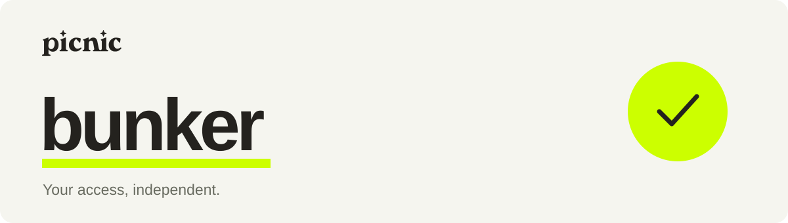

<p align="center">
  
</p>

<p align="center">
  <a href="https://github.com/usePicnic/bunker/actions/workflows/check.yml"></a>
  <a href="LICENSE"></a>
</p>

<p align="center">
  <strong>An independent way back to your Picnic account.</strong><br>
  Open source. Runs locally. Your keys stay with you.
</p>

<p align="center">
  <a href="#get-started">Get started</a> ·
  <a href="#how-it-works">How it works</a> ·
  <a href="#verify-it-yourself">Tests</a> ·
  <a href="docs/architecture.md">Architecture</a>
</p>

---

Bunker helps you find and regain control of your Picnic accounts through your
existing **passkey** or a **connected wallet**, without a Picnic login or backend.
It reads account ownership and recovery rules directly from the blockchain.

**Development preview.** Passkey discovery and guardian recovery are implemented.
The guided withdrawal screen is still a demonstration. A separate recovery
workbench implements asset exits; coverage varies by asset and deployment.
[What is tested, and what is not →](docs/coverage.md)

## How it works

1. **Find your account.** Use a passkey or connect a wallet linked to your Picnic account.
2. **Restore access if needed.** Use the configured guardian when the passkey is unavailable.
   The contract enforces its waiting period; Bunker shows it before authorization.
3. **Prepare your next step.** Review the assets, destination and wallet paying network fees.
   Each real transaction requires your approval in your wallet.

A recovery guardian must **never** become the new owner. Bunker checks this before
signing and sending. A public address by itself does not grant access to an account.

## Get started

You need **Node.js 22.12+**. The local HTTPS/passkey setup currently targets **macOS**.

```sh
git clone https://github.com/usePicnic/bunker.git
cd bunker
npm ci --ignore-scripts
npm run bunker:build
npm run bunker:setup -- prepare
```

`prepare` creates a local review file. Read it before approving the certificate
trust and domain mapping. It does **not** install trust or change your hosts file.
Follow the [local setup, launch and uninstall guide](docs/passkey-proof.md) to
complete installation and start the loopback-only server.

Once running, open the guided flow at
**https://bunker.usepicnic.com:8443/designs/guided.html?design=segments**.
This is a local address configured by setup, not a hosted service.

<details>
<summary><strong>Other development targets</strong></summary>

| Target | Purpose | Start here |
| --- | --- | --- |
| Recovery workbench | External-wallet diagnosis, guardian recovery and implemented asset exits | [Workbench guide](docs/recovery-app.md) |
| Passkey extension | Experimental passkey discovery, validation and withdrawal simulation | [Extension guide](docs/passkey-extension.md) |
| Read-only passkey proof | Isolated signature validation and withdrawal simulation | [Proof guide](docs/passkey-proof.md) |

These targets share components but do not have identical capabilities. The
extension and read-only proof do not broadcast transfers.

</details>

## Verify it yourself

Install [Foundry/Anvil](https://getfoundry.sh/) for local contract tests.

```sh
npm run check
npm run test:bunker:e2e
npm test
```

The recovery lifecycle creates a fresh test passkey and Safe, authorizes recovery
through the guided controller, advances the local chain past the waiting period,
and verifies that the new owner can move test funds. It also checks rejection,
missing gas, resuming after losing UI state, and exclusion of guardians as new owners.

These tests use real contract bytecode on a disposable local chain and software
WebAuthn credentials. They do not replace real browser, biometric or wallet-extension
acceptance tests. [Read the test coverage and limits →](docs/bunker-e2e.md)

Optional fork tests run with `npm run test:fork`. All writes stay inside local Anvil.

## Independence and limits

- **No keys in Bunker.** Never paste a seed, private key, password or OTP into the app.
- **No Picnic backend.** Public RPCs provide chain data. Some discovery routes use
  the public Safe index as an untrusted hint and verify ownership on-chain.
- **External wallet for gas.** Passkey users also need a wallet funded on the relevant networks.
- **WalletConnect is optional.** QR pairing uses its relay; injected wallets do not.
- **Existing authority is required.** An inaccessible Magic account without an
  exported wallet or another configured recovery method remains a limitation.
- **On-chain restrictions still apply.** Delays, token restrictions, protocol pauses
  and liquidity constraints cannot be bypassed.

## Contributing

Keep personal wallet addresses, RPC credentials and local TLS material out of
commits. Use synthetic addresses and disposable local accounts in tests.
See [CONTRIBUTING.md](CONTRIBUTING.md) for setup and checks.

[Architecture](docs/architecture.md) · [Asset coverage](docs/coverage.md) ·
[Third-party notices](NOTICE.md) · [Companion skill](skills/picnic-recovery/SKILL.md)

Made by [Picnic](https://usepicnic.com). MIT for original code; third-party fixtures
retain their upstream licenses.
