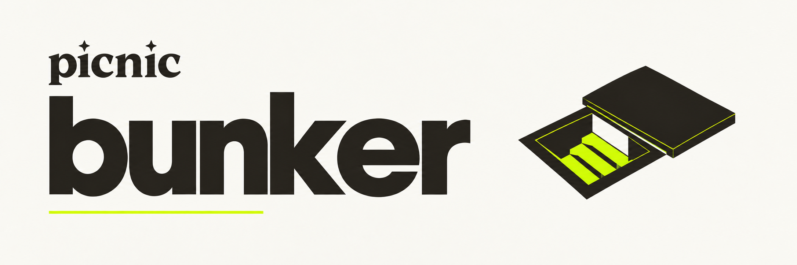

<p align="center">
  
</p>

<p align="center">
  <strong>Access your funds. Even without Picnic.</strong><br>
  A last resort if Picnic is no longer available.<br>
  Built so you have a way out—and hopefully never need one.
</p>

<p align="center">
  <sub>Open source · Runs locally · Your keys stay with you</sub>
</p>

<p align="center">
  <a href="#get-started">Get started</a> &nbsp; / &nbsp;
  <a href="#how-it-works">How it works</a> &nbsp; / &nbsp;
  <a href="#for-contributors">For contributors</a>
</p>

Bunker helps you regain control of your Picnic accounts with an existing
**passkey** or **connected wallet**, without a Picnic login or backend.

## Get started

Copy this into your AI assistant:

```text
Help me recover access to my Picnic account using Bunker: https://github.com/usePicnic/bunker
```

Your assistant sets up Bunker, checks the local installation and opens it in your
browser. Bunker's interface guides the recovery. You make the choices and confirm
passkey and wallet requests yourself; your assistant is available if you have questions.

**macOS for now.** Your assistant checks the prerequisites and asks before
changing local HTTPS settings. Never share a seed, private key or passkey export
in the chat.

> [!NOTE]
> **Development preview.** Account discovery and guardian recovery are implemented.
> Guided withdrawal is still demonstrative. A separate workbench implements asset
> exits, with coverage that varies by asset and deployment.

## How it works

| **01 · Find your account** | **02 · Restore access** | **03 · Prepare your next step** |
| :--- | :--- | :--- |
| Use your passkey or a wallet linked to your Picnic account. | If needed, recover through your configured guardian. Bunker shows the on-chain waiting period before authorization. | Review assets, destination and network fees. Every real transaction requires your approval in your wallet. |

A recovery guardian can never become the new owner. Bunker verifies account
control on-chain; knowing an address alone does not grant access.

<details>
<summary><strong>Independence and limits</strong></summary>

- **No keys in Bunker.** Never paste a seed, private key, password or OTP into the app.
- **No Picnic backend.** Public RPCs provide chain data. Some discovery routes use
  the public Safe index as an untrusted hint and verify ownership on-chain.
- **External wallet for gas.** Passkey users also need a wallet funded on the relevant networks.
- **Existing authority is required.** An inaccessible Magic account without an
  exported wallet or another configured recovery method remains a limitation.
- **On-chain restrictions still apply.** Delays, token restrictions, protocol pauses
  and liquidity constraints cannot be bypassed.

</details>

<details>
<summary><strong>For AI assistants</strong></summary>

Read [the Bunker skill](skills/bunker/SKILL.md) and follow its workflow directly.
This request is about recovering access to a Picnic account; Bunker is the tool.
The skill's job is local setup, verification and launch. The guided UI handles
recovery; after opening it, answer questions or troubleshoot setup when asked.
Passkey, wallet and guardian choices belong in the UI.
For a fresh setup without a supplied revision, resolve the canonical repository's
current `main` to a fixed commit. Check the local environment, obtain approval for
the exact HTTPS changes, then open the UI. Do not require the user to install a skill or learn a
vendor-specific command first. Native skill installation is optional.

See [agent compatibility](docs/agent-compatibility.md) for host capabilities and
handoffs. This remains a development preview, not an authenticated production release.

</details>

## For contributors

[Contribution guide](CONTRIBUTING.md) · [Architecture](docs/architecture.md) ·
[Asset coverage](docs/coverage.md) · [Third-party notices](NOTICE.md)

<details>
<summary><strong>Manual setup and development targets</strong></summary>

```sh
git clone https://github.com/usePicnic/bunker.git
cd bunker
npm ci --ignore-scripts
npm audit --audit-level=high
npm run bunker:build
npm run bunker:setup -- prepare
```

`prepare` creates a local review file. Read it before approving the certificate
trust and domain mapping. It does **not** install trust or change your hosts file.
Follow the [local setup, launch and uninstall guide](docs/passkey-proof.md) to
complete installation and start the loopback-only server.

Once running, open the guided flow at
**https://bunker.usepicnic.com:8443/designs/guided.html?design=segments**.
This is a local address configured by setup, not a hosted service.


| Target | Purpose | Start here |
| --- | --- | --- |
| Recovery workbench | External-wallet diagnosis, guardian recovery and implemented asset exits | [Workbench guide](docs/recovery-app.md) |
| Passkey extension | Experimental passkey discovery, validation and withdrawal simulation | [Extension guide](docs/passkey-extension.md) |
| Read-only passkey proof | Isolated signature validation and withdrawal simulation | [Proof guide](docs/passkey-proof.md) |

These targets share components but do not have identical capabilities. The
extension and read-only proof do not broadcast transfers.

</details>

---

<p align="center">
  Made by <a href="https://usepicnic.com"><strong>Picnic</strong></a><br>
  <sub>MIT for original code. Third-party fixtures retain their upstream licenses.</sub>
</p>

<p align="center">
  <a href="https://github.com/usePicnic/bunker/actions/workflows/check.yml"></a>
  <a href="LICENSE"></a>
</p>
